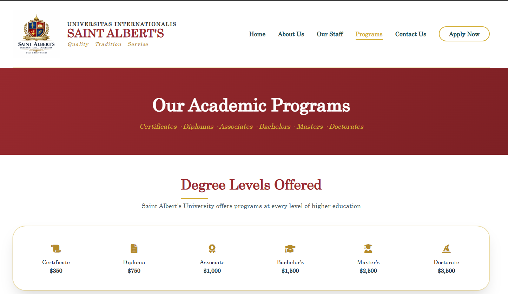

# 🏫 Saint Albert's International University (SAIU)

<div align="center">
  
  <h3>Universitas Internationalis Saint Albert's</h3>
  <p><i>Quality · Tradition · Service</i></p>
</div>

---

[](https://saiu.education/)
[](https://www.php.net/)
[](https://developer.mozilla.org/en-US/docs/Web/HTML)
[](https://developer.mozilla.org/en-US/docs/Web/CSS)

> Saint Albert's International University (SAIU) is a premier online, self-paced institution offering world-class theological and academic education. Bestowed with the Royal Charter of Incorporation by His Majesty Omukama Rukirabasaja Agutamba Dr. Solomon Gafabusa Iguru I (King of Bunyoro Kitara Kingdom, Uganda) and accredited by the Ministry of Education and Sports of Bunyoro Kitara Kingdom, SAIU awards globally recognized Certificates, Associates, Bachelor’s, Masters, and Doctorates.

---

## 📖 Overview

The **SAIU Web Portal** is a modern, responsive, and secure web application designed to handle online applications, student inquiries, academic program listings, and university administration updates. 

This portal acts as the digital campus for SAIU, streamlining the workflow for prospective students worldwide who wish to apply for various courses, review the university prospectus, or get in touch with administration.

**Key Goals of the Portal:**
- **Dynamic Admission Processing**: Collects student profiles, qualifications, and programs securely.
- **Robust Verification**: Implements session-based CAPTCHA check on all inputs.
- **Responsive Branding**: Highlights the royal heritage of the Bunyoro Kitara Kingdom with a premium crimson and gold aesthetic.

**Live Site Link**: [Saint Albert's International University](https://saiu.education/)

---

## ✨ Features

- 🎓 **Complete Academic Catalog** - Comprehensive showcase of degree pathways, course fees, and study modes.
- 📝 **Secure Online Admission Forms** - Real-time registration including details on nationality, qualifications, and program choice.
- 🧩 **Integrated Numeric CAPTCHA** - Spam protection built on server-side PHP sessions (no third-party tracking cookies).
- 📱 **Responsive 3D Layout** - Optimized layout with interactive grids for mobile, tablet, and desktop screens.
- 🏰 **Heritage & Leadership Message** - Dedicated messages from the Chief Patron (His Majesty the King of Bunyoro Kitara Kingdom) and the Rector.
- 🗄️ **Secure File Logging** - Automated logging of submissions into a dedicated folder, configured to prevent leakage on GitHub.

---

## 🛠️ Built With

### Backend & Core Logic
-  **PHP 8.x**: Session management, form processing, automated mail notifications, and file system logging.

### Frontend
-  **HTML5**: Semantic layout for high accessibility and search engine optimization.
-  **CSS3 (Custom Variables)**: Featuring modern flexbox and grid layouts, dynamic hover transitions, custom typography, and the Crimson-Gold color palette.
-  **Font Awesome**: Consistent and sharp iconography for dashboard controls and contact sections.

### Tooling & Security
-  **Git & GitHub**: Version control with customized rules preventing sensitive data leaks.
-  **VS Code**: Recommended development environment.

---

## 📂 Project Structure

To maintain a professional repository layout, the files are organized as follows:

```
saint-albert-university/
├── assets/
│   └── images/              # Logo, backgrounds, and accreditation icons
├── includes/
│   ├── header.php           # Global navigation and responsive style sheet
│   └── footer.php           # Global footer layout and contact cards
├── submissions/             # Form submissions logs (git-ignored for security)
│   ├── contact_submissions.txt
│   └── application_submissions.txt
├── .gitignore               # Excludes submissions logs, OS files, and IDE settings
├── README.md                # Project documentation and guide
├── index.php                # Homepage featuring stats and royal decree
├── about.php                # Accreditation and history details
├── staff.php                # Academic faculty members profile cards
├── programs.php             # Comprehensive course listings and fees structure
├── prospectus.php           # University rules, requirements, and information
├── rector.php               # Rector's message and administrative overview
├── apply.php                # Admission form with math verification
├── contact.php              # Inquiry form with math verification
└── processes.php            # Core backend logic processing form submissions
```

---

## 📸 Screenshots

<table width="100%">
  <tr>
    <td width="50%" align="center">
      <b>🏫 Home Page</b><br/>
      
    </td>
    <td width="50%" align="center">
      <b>📚 Programs & Courses</b><br/>
      
    </td>
  </tr>
  <tr>
    <td width="50%" align="center">
      <b>ℹ️ About Us</b><br/>
      
    </td>
    <td width="50%" align="center">
      <b>👥 Our Staff</b><br/>
      
    </td>
  </tr>
  <tr>
    <td width="50%" align="center">
      <b>📝 Admissions Application</b><br/>
      
    </td>
    <td width="50%" align="center">
      <b>✉️ Contact Desk</b><br/>
      
    </td>
  </tr>
</table>

---

## 🚀 Getting Started

To run this PHP project on your local machine, follow these steps:

### Prerequisites
- [PHP](https://www.php.net/downloads.php) (Version 7.4 or higher installed on your system)

### Running Locally

1. **Clone the repository**
   ```bash
   git clone https://github.com/Jahanzaib-Arain24/Saint-Albert-s-International-University.git
   ```

2. **Navigate to the project folder**
   ```bash
   cd Saint-Albert-s-International-University
   ```

3. **Start the PHP built-in server**
   ```bash
   php -S localhost:5000 router.php
   ```

4. **Access the portal**
   Open your browser and navigate to: `http://localhost:5000`

---

## 💻 Usage

- **Viewing Programs**: Browse the `programs` page to review course details, structure, and registration requirements.
- **Student Admissions**:
  1. Open `apply` and fill out the detailed form.
  2. Solve the numeric security verification (e.g., `4 + 5 = ?`).
  3. Click **Submit Application**. The data will trigger an email to `info@saiu.education` and log locally to `submissions/application_submissions.txt`.
- **Contacting the Team**: Use `contact` to drop general inquiries which are logged under `submissions/contact_submissions.txt`.

---

## 🎯 Security & Design Decisions

### 🔒 User Data Protection
**Challenge**: Form submissions contain personal information (WhatsApp, physical address, qualifications). Storing them in text files is simple, but pushing them to GitHub would violate privacy regulations.
**Solution**: Re-routed all logging outputs to the `submissions/` directory and explicitly blacklisted the entire directory inside `.gitignore`. This keeps the repository clean, professional, and compliant with privacy standards.

### 🎨 Modular PHP Page Builder
**Challenge**: Maintaining style and structure consistency across 8 separate pages.
**Solution**: Extracted standard headers, navigation blocks, and layouts into `includes/header.php` and `includes/footer.php`, ensuring changes to menus or icons are propagated globally instantly.

---

## 🤝 Contributing

Contributions are welcome! If you have suggestions for enhancements or bug fixes:

1. Fork this repository
2. Create your branch (`git checkout -b feature/AmazingFeature`)
3. Commit your changes (`git commit -m 'Add some AmazingFeature'`)
4. Push to the branch (`git push origin feature/AmazingFeature`)
5. Open a Pull Request

---

## 📝 License

This project is licensed under the MIT License - see the [LICENSE](LICENSE) file for details.

---

## 👤 Author

**Muhammad Jahanzaib**

- 🌐 Portfolio: <a href="https://jahanzaib-24.vercel.app/" target="_blank">Jahanzaib-Portfolio</a>
- 💼 LinkedIn: <a href="https://www.linkedin.com/in/jahanzaib-arain/" target="_blank">@Jahanzaib-Arain</a>
- 📧 **Email:** <a href="mailto:arainjhanzaib@gmail.com" target="_blank">arainjhanzaib@gmail.com</a>
- 💻 GitHub: <a href="https://github.com/Jahanzaib-Arain24" target="_blank">@Jahanzaib-Arain24</a>

---

<div align="center">

**⭐ Star this repo if you find it helpful!**

Made with ❤️ by Muhammad Jahanzaib

</div>
